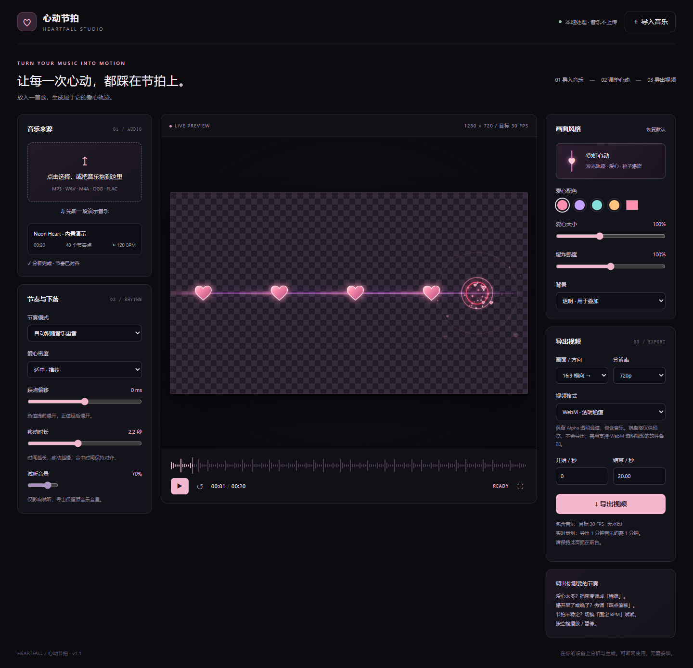

# 心动节拍 · Heartfall Studio

将音乐变成发光爱心轨迹：自动识别节奏，爱心在判定圈处踩点炸开。

**[在线打开](https://rikka-zzz.github.io/heartfall-studio/)** · **[下载离线版](downloads/heartfall-v1.1.zip)** · **[详细使用说明](USAGE.md)**



## 功能

- 自动分析音乐重音，提前生成爱心，在对应时间到达判定圈。
- 9:16 竖向下落、1:1 方形下落、16:9 横向向右移动。
- 爱心颜色、大小、密度、移动时长、命中偏移与爆炸强度调节。
- 自动重音 / 固定 BPM 两种模式。
- 720p / 1080p，支持导出整首音乐或选定片段。
- MP4、WebM，以及保留 Alpha 的透明 WebM（视浏览器能力提供）。
- 本地处理音频，无账号、无后端、无音乐上传；内置原创合成演示。

## 使用

推荐使用最新版 Microsoft Edge 或 Google Chrome。

1. 打开在线版，或下载离线包后双击 `心动节拍.html`。
2. 导入音乐，等待分析完成，播放预览。
3. 选择画面方向与风格。横版选择「16:9 横向 →」。
4. 透明视频选择「WebM · 透明通道」。棋盘格仅供预览，不会被导出。
5. 点击导出并保持页面在前台。导出时间与片段时长接近。

透明 WebM 需要支持 WebM Alpha 的剪辑或合成软件。部分播放器会把透明区域显示成黑色。自动重音检测与 BPM 是估计值，可调整密度、偏移或手动 BPM。实际录制帧率受设备性能影响。

## 本地开发

零第三方运行依赖，不需要 `npm install`。Node.js 18 或更新版本可构建单文件应用：

```sh
npm run build
```

- `src/`：界面、样式、节奏分析与渲染源文件。
- `scripts/build.mjs`：把源文件合并为根目录 `index.html`。
- `index.html`：可直接打开的静态成品，也是 GitHub Pages 首页。
- `downloads/`：便于离线使用的小程序包。

修改 `src/` 后运行构建，提交生成的 `index.html` 并推送 `main`，GitHub Pages 会自动更新。Pages 发布源为 `main` 分支的根目录，`.nojekyll` 用于直接发布静态文件。

## 验证

已验证离线音乐分析、播放暂停、文件导入、导出取消、移动端布局、横向移动、MP4 / WebM 导出。透明 WebM 通过实际解码检查：包含透明背景、半透明光晕与非静音音轨。

## 参考

开发前参考了以下项目的思路，应用独立编写，不依赖其代码运行：

- [BeatDetector](https://github.com/stasilo/BeatDetector)
- [Web Audio Visualizer](https://github.com/dmeldrum6/Web-Audio-Visualizer)
- [notefall](https://github.com/ekkx/notefall)
